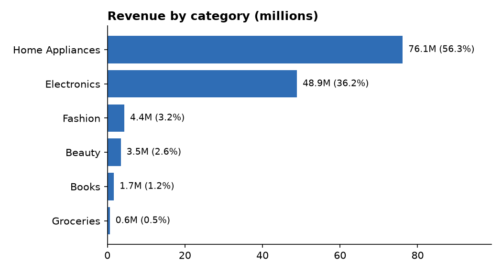
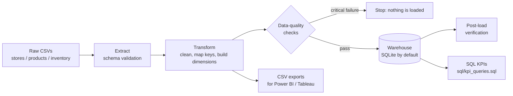
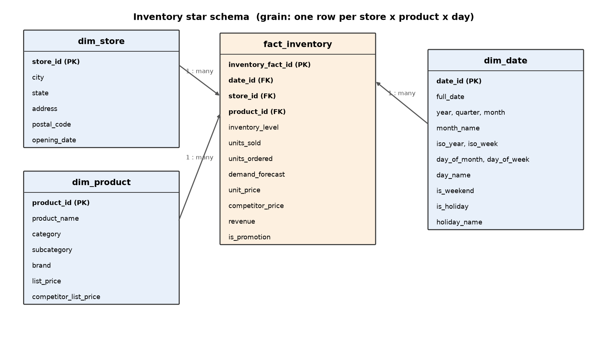
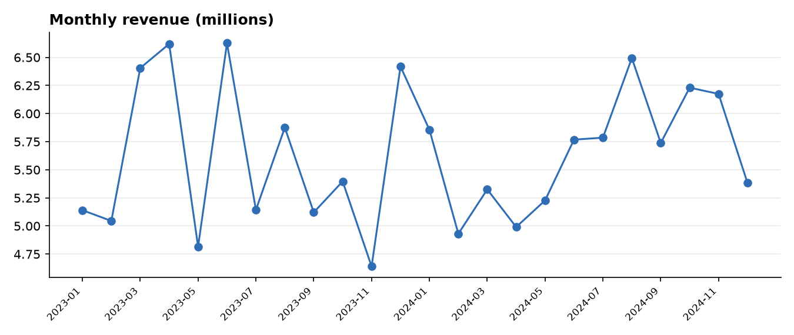
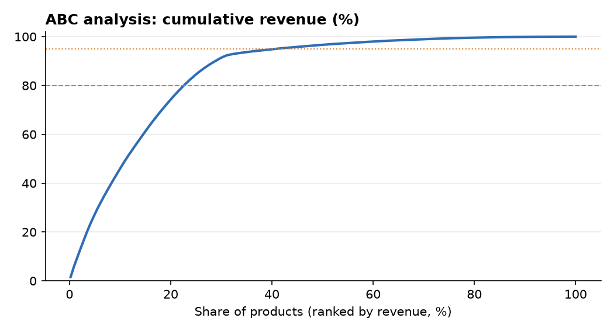

# Inventory Data Warehouse

An end-to-end data pipeline that turns raw retail inventory files into a **star-schema data warehouse**, validates it with **automated data-quality checks**, and answers inventory questions with **SQL KPIs** (turnover, days of stock, stock-outs, excess inventory, ABC analysis, growth).

Originally a course project (IT300 Business Intelligence), rebuilt as a reproducible, tested Python + SQL pipeline.



## Architecture



## Star schema



**Grain:** one row per store × product × day (a sparse daily snapshot). The grain is enforced by a `UNIQUE` constraint, and all foreign keys are enforced by the database.

## Quick start

Requires Python 3.10+.

```bash
python -m venv .venv
source .venv/bin/activate          # Windows: .venv\Scripts\activate
pip install -r requirements.txt

python -m src.pipeline             # build the warehouse (warehouse/inventory_dwh.db) + CSV exports
python -m pytest                   # run the tests
python -m src.make_charts          # regenerate the charts in docs/img
```

Run any KPI from Python:

```python
from src.db import get_engine
from src.kpis import run_kpi

print(run_kpi(get_engine(), "kpi_overview"))
```

To use another database (for example MySQL), copy `.env.example` to `.env` and set `DATABASE_URL`. Credentials are read from the environment and never stored in code.

## Project structure

```
data/raw/            input CSVs (stores, products, inventory snapshots)
data/processed/      pipeline output: dimension + fact CSVs (ready for Power BI) and dq_report.json
sql/schema.sql       star-schema DDL (keys, constraints, indexes)
sql/kpi_queries.sql  15 named KPI queries with their definitions
src/                 extract.py, transform.py, quality.py, load.py, pipeline.py, kpis.py, make_charts.py,
                     make_schema_diagram.py
tests/               pipeline, data-quality and KPI tests
docs/                charts and star-schema diagram
.github/workflows/   CI: runs the pipeline and the tests on every push
```

## Data quality

The pipeline runs these checks before loading (a critical failure stops the run) and again after loading:

| Check | Type |
|---|---|
| Primary keys unique in every table | critical |
| Fact grain (date, store, product) unique | critical |
| No nulls in required columns | critical |
| Every fact row has a matching store, product and date | critical |
| Measures non-negative, prices positive, `revenue = units_sold × unit_price` | critical |
| No sales dated before the store's opening date | critical |
| Row counts in the database match what was transformed; no orphan rows in SQL | critical |
| Units sold greater than recorded inventory, stores/products without activity | warning |

Results are written to `data/processed/dq_report.json`.

## KPI definitions

| KPI | Definition |
|---|---|
| Annualized inventory turnover | `365 × AVG(units_sold) / AVG(inventory_level)` |
| Days sales of inventory (DSI) | `AVG(inventory_level) / AVG(units_sold)` (≈ 365 / turnover) |
| Stock-out rate | snapshots with `inventory_level = 0` ÷ all snapshots |
| Excess inventory % | `SUM(max(inventory_level − demand_forecast, 0)) / SUM(inventory_level)` |
| Forecast WAPE / bias | `SUM(ABS(sold − forecast)) / SUM(sold)` and `(SUM(forecast) − SUM(sold)) / SUM(sold)` |
| ABC class | A = products making up the first 80% of revenue, B = next 15%, C = remaining 5% |

## Sample results

Computed by `sql/kpi_queries.sql` on the warehouse built from the included data:

| KPI | Value |
|---|---|
| Snapshots / units sold | 6,424 / 162,061 |
| Revenue | 135.2M |
| Annualized turnover / DSI | 36.8 / 9.9 days |
| Stock-out rate | 0.26% |
| Excess inventory | 56.9% |
| Revenue share: Home Appliances + Electronics | 92.5% |
| ABC: class A | 100 products = 79.6% of revenue |




**These figures illustrate the pipeline; they are not business conclusions** (see the notes below).

## Notes on the data and design decisions

- **The data is synthetic.** Stores and products were generated with Faker/NumPy; inventory values are uniformly random. Consequences: demand forecasts are always above actual sales (so forecast WAPE and bias are identical, around 400%), and category revenue is driven mostly by price level.
- **The raw inventory file has no usable product key.** Its `Product_ID` is a row counter, and 92% of its values do not exist in the product table. Rather than joining by row position (what v1 did), each row is mapped to a product of the *same category and subcategory* using a seeded random generator (`PIPELINE_SEED`, default 42), so the output is deterministic. In a real system the source would carry a real product key.
- **Prices come from the product dimension** (`unit_price` = list price), so revenue is consistent with the product table.
- **Totals depend on how many snapshots exist.** Data is a sparse daily sample, so the KPI queries also report `snapshots`, and rate-style KPIs use averages.
- **5 of the 10 stores have no inventory data.** They are kept in `dim_store` and appear with zero revenue in the `store_performance` query (a `LEFT JOIN` on purpose).
- **Full refresh, not incremental.** Each run drops and rebuilds the schema, which makes it idempotent and simple to reason about.
- **Holidays are fixed-date Indian public holidays only** (Republic Day, Independence Day, Gandhi Jayanti, Christmas). Movable festivals are not included.
- **Database support:** SQLite is the default and the only backend covered by the tests. The SQL is kept portable (CTEs, window functions) so it should also run on MySQL 8 or PostgreSQL through `DATABASE_URL`.

## What changed from v1

| v1 (course project) | This version |
|---|---|
| Product attributes attached to inventory rows **by row position** | Rows mapped to valid products by category/subcategory; foreign keys enforced and tested |
| Connection string with credentials inside notebooks | Credentials read from environment variables; `.env` is git-ignored |
| Seven notebooks run by hand | One command: `python -m src.pipeline` |
| Date dimension built only from the dates present in the data, with index-based IDs | Complete calendar with `yyyymmdd` keys, ISO weeks and weekend/holiday flags |
| Holiday flag copied row by row onto dates | Holiday defined once per date; promotion kept as a separate fact attribute |
| All 85 Home Appliances products had the brand `GenericBrand` | Brand lookup fixed |
| KPI queries stored in a Word document | Version-controlled `.sql` with documented definitions, executed by the tests; forecast error reported as WAPE and bias; growth ordered by year and month; no `CURDATE()`-style non-deterministic results |
| No checks, no tests | 26 data-quality checks and a pytest suite, also run by CI |
| Static PDF report | Results generated by code (see *Sample results*) |

## Possible next steps

Docker image, orchestration (Airflow or Prefect), incremental loads with upserts, slowly changing price history (SCD type 2), dbt models, and PostgreSQL as a target.

---
*Author: Meryem Mchiri*